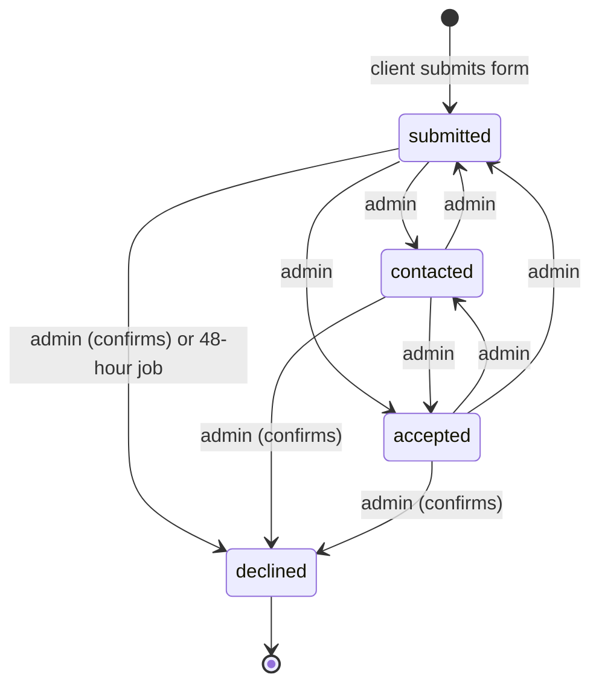

# Booking request state machine

- **Date:** 2026-10-13
- **Sources:** `docs/requirements.md` (FR/NFR numbers below), `docs/reviews/R1.md`, author's answers on 2026-10-13
- **Related:** `data-model.md` (tables and constraints named below)

## States



Declined is final: no move leaves it. Every other move between submitted, contacted and accepted is allowed, in both directions.

## Moves, who triggers them, and side effects

| From | To | Triggered by | Side effects |
|---|---|---|---|
| (none) | submitted | Client, by submitting the form | Day or days locked. Confirmation email to client. Notification email to management team. Network address stored on the booking. |
| submitted | contacted | Admin | None |
| submitted | accepted | Admin | Confirmation email to client |
| submitted | declined | Admin, after confirming; or the 48-hour job | Day or days freed. No email to client. |
| contacted | submitted | Admin | None |
| contacted | accepted | Admin | Confirmation email to client |
| contacted | declined | Admin, after confirming | Day or days freed. No email to client. |
| accepted | contacted | Admin | None |
| accepted | submitted | Admin | None |
| accepted | declined | Admin, after confirming | Day or days freed. No email to client. |
| declined | any | Nobody | Refused by the database |

Every move also updates `bookings.state_changed_at`.

## Side effects in detail

**Day lock on submit (FR10).** Inserting the booking is what takes the lock: the `bookings_one_per_day` constraint refuses the insert if any of its days is held by another non-declined booking. A booking past midnight holds both days.

**Day freed on decline (FR10, FR12).** No separate step. A declined row falls outside `bookings_one_per_day`, so its days are free as soon as the state change is saved.

**Emails (FR17).**

- On submit: confirmation to the client, notification to the management team.
- On a move into accepted: confirmation to the client.
- On decline, by admin or by the job: nothing is sent to the client.

**Confirmation before decline (FR11).** The admin is asked to confirm before any move into declined. The 48-hour job does not ask anyone.

## The 48-hour auto-decline job (FR12)

- **Runs every hour.**
- Declines every booking that is in `submitted` and whose `submitted_at` is 48 hours or more in the past. The 48 hours run through all days, including weekends.
- Bookings in `contacted` or `accepted` are never touched by the job.
- Because it runs hourly, a booking is declined between 48 and 49 hours after it was submitted, not at exactly 48 hours.
- `submitted_at` is set once and never changes.

```sql
UPDATE bookings
SET state = 'declined', state_changed_at = now()
WHERE state = 'submitted'
  AND submitted_at <= now() - interval '48 hours';
```

The update is a single statement, so a booking the admin moves out of `submitted` at the same moment is either moved by the admin or declined by the job, never both.

## Other scheduled work (not state changes)

- **6-month removal (NFR7).** Erases the client details of bookings whose `submitted_at` is 6 months or more in the past. It does not change the state. How often it runs is not decided.

## Points for the author

1. **This differs from FR11 as written.** FR11 lets accepted go back to contacted only. You confirmed on 2026-10-13 that accepted to submitted is also allowed. `requirements.md` has not been changed.
2. **Moving back to submitted after 48 hours.** The job counts from the original submission. A booking moved from contacted or accepted back to submitted more than 48 hours after it was submitted is declined at the next hourly run, and declined is final.
3. **Accepting twice.** A booking can go accepted, contacted, accepted. As designed, the client gets a confirmation email on every move into accepted. Whether a second email is wanted is not decided.
4. **A client who is told nothing.** After an auto-decline the client holds a submission confirmation and never hears anything else (FR17).
5. **Decline confirmation** is an admin page step. Whether the server also refuses a decline that arrives without the confirmation is not decided; the rules table assumes it does.

## Rules the system must never break

"Test" names the test that will prove the rule. **None of these tests exist yet**; the names are proposals, to be written before the code (CLAUDE.md rule 2), with expected values taken from the requirements.

| # | Rule | Enforced where | Test that proves it (planned) |
|---|---|---|---|
| 1 | At most one non-declined booking per calendar day (FR10) | DB: `bookings_one_per_day` | `tests/db/test_day_lock.py::test_second_booking_on_same_day_is_refused` |
| 2 | A booking that runs past midnight locks both days (FR10) | DB: `locked_days` + `bookings_one_per_day` | `tests/db/test_day_lock.py::test_overnight_booking_locks_both_days` |
| 3 | Declining a booking frees its day or days (FR10) | DB: `bookings_one_per_day` excludes declined | `tests/db/test_day_lock.py::test_declined_booking_frees_its_days` |
| 4 | A declined booking never changes state (FR11) | DB: trigger `bookings_declined_is_final` | `tests/db/test_states.py::test_declined_booking_cannot_change_state` |
| 5 | State is one of submitted, contacted, accepted, declined (FR11) | DB: `bookings_state_valid` | `tests/db/test_states.py::test_unknown_state_is_refused` |
| 6 | A booking lasts at least 1 hour and ends after it starts (FR13) | DB: `bookings_min_one_hour` | `tests/db/test_booking_times.py::test_booking_under_one_hour_is_refused` |
| 7 | A booking that is not erased has name, phone, email, guest count and both ticks (FR5) | DB: `bookings_erased_or_complete` | `tests/db/test_erasure.py::test_booking_without_both_ticks_is_refused` |
| 8 | An erased booking keeps only its date and state (FR18) | DB: `bookings_erased_or_complete` | `tests/db/test_erasure.py::test_erased_booking_has_no_client_details` |
| 9 | Admin email addresses are unique (NFR1) | DB: `admin_users_email_unique` | `tests/db/test_admin_users.py::test_duplicate_admin_email_is_refused` |
| 10 | Only a logged-in admin, or the 48-hour job, changes a state (FR11) | App | `tests/api/test_state_changes.py::test_state_change_without_admin_session_is_refused` |
| 11 | A decline by the admin requires confirmation (FR11) | App | `tests/api/test_state_changes.py::test_decline_without_confirmation_is_refused` |
| 12 | A booking still submitted 48 hours after submission is declined by the job (FR12) | App: hourly job | `tests/jobs/test_auto_decline.py::test_submitted_booking_older_than_48h_is_declined` |
| 13 | The job never declines a contacted or accepted booking (FR12) | App: hourly job | `tests/jobs/test_auto_decline.py::test_contacted_and_accepted_bookings_are_left_alone` |
| 14 | No booking for a past date or time (FR13) | App | `tests/api/test_booking_form.py::test_past_start_time_is_refused` |
| 15 | No booking more than 6 months in advance (FR13) | App | `tests/api/test_booking_form.py::test_start_more_than_six_months_ahead_is_refused` |
| 16 | At most 5 requests per network address (per /64 block for IPv6) in a rolling 24 hours (NFR3) | App, counting `bookings.client_ip` | `tests/api/test_rate_limit.py::test_sixth_request_in_24h_is_refused` |
| 17 | At most 2 held slots per person, matched on phone or email; a held slot is a non-declined booking whose event is not yet past (FR15) | App | `tests/api/test_slot_limit.py::test_third_slot_with_same_email_is_refused`, `::test_third_slot_with_same_phone_is_refused` |
| 18 | A submission without a passed CAPTCHA is refused (NFR3) | App | `tests/api/test_booking_form.py::test_submission_without_captcha_is_refused` |
| 19 | Guest count within bounds; every field within its length limit and of the right type (FR16) | App (values not decided) | `tests/api/test_booking_form.py::test_guest_count_out_of_bounds_is_refused`, `::test_overlong_field_is_refused` |
| 20 | Client is emailed on submit and on accept, and never on decline (FR17) | App | `tests/api/test_emails.py::test_client_emailed_on_submit_and_accept`, `::test_client_not_emailed_on_decline` |
| 21 | Management team is emailed on every new request (FR17) | App | `tests/api/test_emails.py::test_team_emailed_on_submit` |
| 22 | Client details are erased 6 months after submission (NFR7) | App: scheduled job | `tests/jobs/test_retention.py::test_booking_older_than_six_months_is_erased` |
| 23 | The admin page is unreachable without logging in (NFR1) | App | `tests/api/test_admin_auth.py::test_admin_page_without_session_is_refused` |
| 24 | An admin session ends after 30 minutes of inactivity (NFR2) | App | `tests/api/test_admin_auth.py::test_session_expires_after_30_minutes_idle` |
| 25 | Log files contain no personal data (NFR5) | App | `tests/api/test_logging.py::test_submitted_client_details_do_not_appear_in_logs` |

Rules 16 and 17 are counting checks made in the application just before the insert. Since F01 (L5) booking submissions are processed one at a time, so two submissions arriving at the same instant cannot both pass the check.
